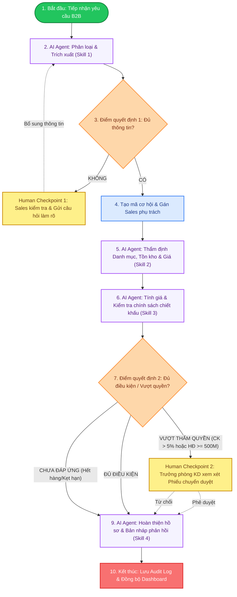

# AI301 - AI AGENT | ĐỀ ÁN 01: HỆ THỐNG AI AGENT XỬ LÝ CƠ HỘI BÁN HÀNG B2B - MINH AN COMPANY 🚀
> **Phong cách thiết kế giao diện:** Pastel Butter-Yellow & Warm Amber Glassmorphism (DataLens Studio · Lê Yến Như)  
> **Địa chỉ trải nghiệm Localhost:** [http://localhost:8888](http://localhost:8888)

---

## 🌟 1. Giới Thiệu Dự Án & Mục Tiêu

### 1.1. Bối cảnh doanh nghiệp
- **Doanh nghiệp:** Công ty Minh An – Doanh nghiệp chuyên phân phối thiết bị công nghệ và hạ tầng viễn thông cho khách hàng B2B.
- **Quy mô tiếp nhận:** 6 nhân viên kinh doanh xử lý trung bình 180 yêu cầu/tuần qua Email và Biểu mẫu Web.
- **Đặc thù yêu cầu:** Mỗi yêu cầu chứa nhiều danh mục sản phẩm, số lượng lớn, hạn mức ngân sách, tiến độ bàn giao khắt khe và đề xuất chiết khấu thương mại.

### 1.2. Mục tiêu hệ thống AI Agent
1. Tự động hóa trích xuất và bóc tách thực thể từ văn bản tự nhiên (Skill 1).
2. Phát hiện chính xác các trường dữ liệu còn thiếu hoặc mơ hồ, tự động sinh bộ câu hỏi làm rõ.
3. Đối chiếu thời gian thực với Master Catalog, tồn kho khả dụng và thời gian giao hàng (Skill 2).
4. Tính toán giá trị đề xuất và áp dụng ma trận thẩm quyền chiết khấu (Skill 3).
5. Phân loại cơ hội thành 4 trạng thái chuẩn nghiệp vụ và lập Phiếu chuyển duyệt (Skill 4).
6. Duy trì nhật ký truy vết Audit Log minh bạch 100%.

> [!IMPORTANT]
> **Nguyên tắc bất khả xâm phạm:** AI Agent không tự xác nhận bán hàng, không tự cam kết giá hoặc tiến độ khi chưa thẩm định kho, không tự phê duyệt các trường hợp vượt thẩm quyền.

---

## 📊 2. Phân Tích Quy Trình Hiện Tại (AS-IS) & Bảng Tác Động Nghiệp Vụ

| STT | Vấn Đề Nghiệp Vụ | Nguyên Nhân Gốc Rễ | Tác Động Đến Thời Gian | Tác Động Đến Độ Chính Xác | Tác Động Đến Hiệu Quả Kinh Doanh |
| :--- | :--- | :--- | :--- | :--- | :--- |
| **01** | **Bỏ sót sản phẩm & tính sai giá** | Tra cứu thủ công bảng giá Excel cũ; sót phụ kiện trong email dài của khách | Kéo dài 4 - 8 giờ/yêu cầu | Sai lệch đơn giá 5% - 15% | Thâm hụt biên lợi nhuận hoặc khách hàng khiếu nại |
| **02** | **Cam kết sai tiến độ giao hàng** | Kinh doanh tự cam kết không đối chiếu tồn kho khả dụng và lead-time nhập khẩu | Trễ hạn hợp đồng từ 7 - 14 ngày | Lệch số lượng thực tế 80% | Bị phạt hợp đồng, mất uy tín thương hiệu B2B |
| **03** | **Tắc nghẽn phê duyệt chiết khấu** | Thiếu thông tin ngân sách/người duyệt khiến hồ sơ bị chuyển qua lại giữa Sales và Quản lý | Thời gian chờ duyệt kéo dài 48 - 72 giờ | Thiếu căn cứ định giá | Khách hàng chuyển sang đối thủ cạnh tranh |

---

## 🔄 3. Quy Trình Đề Xuất (TO-BE) - 10 Bước Khép Kín



---

## 🤖 4. Thiết Kế 4 Kỹ Năng Nghiệp Vụ (Skills Architecture)

| Kỹ Năng | Mục Tiêu (Objective) | Dữ Liệu Đầu Vào (Input) | Công Cụ & Thư Viện (Tools) | Đầu Ra Chuẩn Hóa (Output) |
| :--- | :--- | :--- | :--- | :--- |
| **Skill 1: Request Analyzer** | Bóc tách thực thể phi cấu trúc | Email/Biểu mẫu khách hàng | NLP Entity Regex Parser | JSON thông tin khách, SKU, SL, Ngân sách, Hạn chót, Chiết khấu |
| **Skill 2: Inventory Validator** | Đối chiếu danh mục & kho | Danh sách SKU & Hạn chót | Master Catalog, Stock Engine | Bảng thẩm định tồn khả dụng, thời gian giao hàng chuẩn/hỏa tốc |
| **Skill 3: Pricing Calculator** | Tính toán giá trị & Thẩm quyền | Đơn giá, SL, Chiết khấu | Pricing Engine, Policy Matrix | Giá trước CK, Số tiền CK, Giá sau CK, Kiểm tra ngưỡng 5% & 500M |
| **Skill 4: Response Generator** | Tổng hợp hồ sơ & văn bản | Kết quả từ Skill 1, 2, 3 | Template Engine, Ticket Generator | Hồ sơ cơ hội B2B, Dự thảo Email làm rõ/báo giá, Phiếu chuyển duyệt |

---

## 🧪 5. Kết Quả Kiểm Thử Thực Tế (4 Test Cases)

1. **Test Case 1 (Tiêu chuẩn): Công ty DigiTech**
   - *Yêu cầu:* 10 Laptop Dell Vostro 5630 + 5 Màn hình Dell 24". Ngân sách 250M, giao 7 ngày, CK 4%.
   - *Kết quả:* Đủ tồn kho (45/10 và 60/5). CK 4% $\le$ 5% (thuộc thẩm quyền Sales). Tổng sau CK: 197,760,000 đ $\le$ 250M.
   - *Trạng thái:* **Có thể tiếp tục (ĐẠT)**.

2. **Test Case 2 (Thiếu dữ liệu): Tập đoàn Dược Phẩm An Khang**
   - *Yêu cầu:* Server Dell R450 + Switch Cisco (chưa rõ số lượng). Ngân sách & thời hạn chưa xác định.
   - *Kết quả:* Phát hiện thiếu 4 trường bắt buộc. Tự sinh 4 câu hỏi làm rõ và soạn dự thảo email đề nghị bổ sung.
   - *Trạng thái:* **Cần bổ sung thông tin (ĐẠT)**.

3. **Test Case 3 (Ranh giới quy tắc): Viễn Thông Toàn Cầu**
   - *Yêu cầu:* 30 Router Cisco C8200L. Kho còn đúng 30 chiếc. Yêu cầu chiết khấu 10%, ngân sách 700M.
   - *Kết quả:* Tổng sau CK: 661,500,000 đ. Vượt thẩm quyền Sales 5% (10% yêu cầu) và vượt ngưỡng hợp đồng lớn (500M).
   - *Trạng thái:* **Chờ duyệt (ĐẠT)**. Tự động sinh Phiếu chuyển duyệt số `APV-2026-003` trình Trưởng phòng Kinh doanh.

4. **Test Case 4 (Không đáp ứng): Khách sạn Grand Plaza**
   - *Yêu cầu:* 50 Máy in Laser HP giao trong 3 ngày.
   - *Kết quả:* Tồn kho chỉ còn 12 máy (thiếu 38 máy). Thời gian nhập hàng bổ sung là 24 ngày (> 3 ngày yêu cầu).
   - *Trạng thái:* **Chưa đáp ứng (ĐẠT)**. Tự động đề xuất phương án giao 2 đợt hoặc đổi model tương đương.

---

## 🚀 6. Hướng Dẫn Khởi Động Trực Tiếp

Chỉ cần chạy lệnh sau trong Terminal:
```bash
./start_localhost.sh
```

Mở trình duyệt truy cập:
👉 **[http://localhost:8888](http://localhost:8888)**

Hệ thống hỗ trợ đầy đủ các tính năng:
- **Dashboard BI tương tác:** Theo dõi thời gian thực 4 nhóm trạng thái và biểu đồ phân bổ.
- **AI Agent Studio:** Thử nghiệm ngay các Test Case hoặc nhập yêu cầu khách hàng bất kỳ.
- **Phê duyệt Human-in-the-Loop:** Trưởng phòng có thể bấm trực tiếp nút `[Phê Duyệt]` hoặc `[Từ Chối]`.
- **Xuất Báo Cáo:** 1-Click xuất file Word (.doc) và Excel (.csv) chuẩn hóa cho doanh nghiệp.
